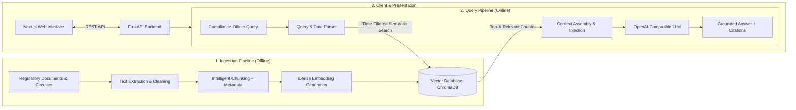

# ChronoLex

## Tagline

> **Find the rule. Know when it applied. See why.**

---

## Problem Statement

A large bank maintains thousands of compliance circulars, regulatory advisories (e.g., RBI, SEC, Basel Committee), internal audit directives, and policy updates. When evaluating a specific transaction—such as a cross-border remittance, credit authorization, or high-value correspondent account operation—risk and compliance officers face a significant bottleneck:

- **Historical Contradictions & Amendments**: Regulations are frequently amended, clarified, or superseded over time. A circular issued in 2021 might be modified by an addendum in 2023 and partially revoked in 2024.
- **Time Inconsistency**: Compliance officers cannot simply ask *"What is the rule?"*—they must determine *"What rule was in force on the exact date of this transaction?"*
- **Audit Risk & Hallucination**: Generic AI tools or manual skim-reading can introduce hallucinations or miss critical carve-outs. Audits demand line-item traceability back to the authoritative text, circular paragraph, and effective date.

Compliance officers currently spend hours manually reconciling conflicting historical PDFs, exposing the institution to compliance breaches, regulatory fines, and operational delays.

---

## Proposed Solution

**ChronoLex** is a time-aware, source-grounded Retrieval-Augmented Generation (RAG) assistant tailored specifically for banking compliance and risk officers.

Instead of relying on general LLM memory, ChronoLex anchors every answer in the organization's verified document repository. By indexing regulatory documents alongside temporal metadata (`effective_from`, `effective_to`, `supersedes_id`, `issuing_authority`), ChronoLex performs date-scoped semantic retrieval to identify the exact rule governing any transaction date, synthesizing clear explanations with verifiable line-by-line citations and explicit refusal guardrails when evidence is insufficient.

---

## Core Idea

The end-to-end information flow follows a rigorous RAG pipeline:

```
Regulatory Documents (PDFs, Circulars, Directives)
   │
   ▼
Text Extraction (Layout-aware document parsing)
   │
   ▼
Cleaning & Normalization (Header/footer stripping, boilerplate removal)
   │
   ▼
Intelligent Chunking (Hierarchical section & clause boundary splitting)
   │
   ▼
Metadata Enrichment (Source, Circular No., Effective Date, Authority, Status)
   │
   ▼
Embedding Generation (Dense vector representations via embedding model)
   │
   ▼
Vector Database (ChromaDB collection with payload metadata index)
   │
   ▼
Time-Aware Retrieval (Semantic similarity + Temporal date-range filtering)
   │
   ▼
Context Injection (Assembled prompt with strictly bounded evidence)
   │
   ▼
LLM Generation (Deterministic reasoning instructions)
   │
   ▼
Grounded Answer + Citations (Exact circular, section, paragraph, and date)
```

---

## Key Features

| Feature | Status | Description |
|---|---|---|
| **OpenAI-Compatible LLM API Access** | 🟢 **Implemented** | Configurable client, chat completions, usage tracking, backoff & error handling. |
| **Regulatory Document Ingestion** | ⏳ *Planned (Week 2)* | Automated ingestion of multi-page PDF circulars and regulatory directives. |
| **PDF Text Extraction & Cleaning** | ⏳ *Planned (Week 2)* | Robust parsing preserving tables, section headers, and removing recurrent noise. |
| **Intelligent Chunking** | ⏳ *Planned (Week 2)* | Clause-aware token chunking with sliding overlap to maintain regulatory context. |
| **Metadata & Provenance Tracking** | ⏳ *Planned (Week 2)* | Attribution tagging for circular number, issuing authority, and effective date ranges. |
| **Embedding Generation** | ⏳ *Planned (Week 3)* | Batch vector generation using OpenAI-compatible embedding models. |
| **Semantic & Top-K Retrieval** | ⏳ *Planned (Week 3)* | Cosine distance similarity search across indexed regulatory chunk vectors. |
| **Time-Aware / Metadata Filtering** | ⏳ *Planned (Week 3)* | Hard date-boundary queries (`transaction_date BETWEEN effective_from AND effective_to`). |
| **RAG Pipeline & Context Injection** | ⏳ *Planned (Week 4)* | Structured prompt synthesis binding retrieved evidence to LLM reasoning. |
| **Source Citation & Attribution** | ⏳ *Planned (Week 4)* | Traceable references linking statements to specific circulars and paragraphs. |
| **Hallucination Guardrails & Refusal** | ⏳ *Planned (Week 4)* | Deterministic fallback refusing to guess when evidence is missing or ambiguous. |
| **Conflict & Version Resolution** | ⏳ *Planned (Week 4)* | Explicit detection of superseded circulars vs. currently active directives. |
| **Interactive Query Interface** | ⏳ *Planned (Week 5)* | Next.js chat interface with streaming answers and interactive citation inspectors. |
| **RAG Evaluation & Monitoring** | ⏳ *Planned (Week 5)* | Automated benchmarking for faithfulness, answer relevance, and retrieval recall. |

*Status Legend:*
- 🟢 **Initialized**: Scaffolding, verification endpoints, and foundation complete.
- ⏳ **Planned**: Scheduled for implementation during subsequent sprint milestones.

---

## Architecture



---

## Technology Stack

| Technology | Role | Rationale |
|---|---|---|
| **Python 3.11+** | Backend & AI Runtime | De facto standard for AI, NLP, document parsing, and RAG pipelines. |
| **FastAPI** | Backend Web Framework | High-performance asynchronous REST API with automatic OpenAPI documentation and native Pydantic validation. |
| **Next.js 16 (React 19)** | Frontend Web Framework | Fast, server-rendered and client-interactive UI supporting modern React paradigms and streaming responses. |
| **TypeScript** | Frontend Language | Static type safety ensuring contract consistency across API interactions and citation rendering. |
| **Tailwind CSS** | Styling | Modern, utility-first styling for dark-mode interfaces, crisp typography, and high-density compliance data views. |
| **OpenAI-Compatible LLM API** | Inference Provider | Industry-standard API surface (`/v1/chat/completions`) enabling flexible model switching (OpenAI, local Ollama, vLLM, or Azure). |
| **Embedding Model** | Vector Representation | Dense semantic representations (e.g., `text-embedding-3-small`) capturing legal and financial nuances. |
| **ChromaDB** | Vector Database | Selected for development and local embedded persistence with zero external service overhead, combined with native metadata filtering. (See [ADR 0001](file:///Users/prithvisingh/Documents/S63_LexTrace_SPD/docs/decisions/0001-vector-database-selection.md)). |
| **Git & GitHub** | Version Control | Standard collaborative workflow with feature branching and auditable change logs. |

---

## Repository Structure

```
ChronoLex/
│
├── apps/
│   ├── api/                     # Python FastAPI Backend
│   │   ├── app/
│   │   │   ├── main.py          # FastAPI application entrypoint & health routes
│   │   │   ├── api/             # REST route controllers (future endpoints)
│   │   │   ├── core/            # App configuration and environment loading
│   │   │   ├── models/          # Pydantic data models & schemas
│   │   │   ├── services/        # RAG, retrieval, embedding, and LLM services
│   │   │   └── utils/           # Shared utility functions
│   │   ├── tests/
│   │   │   └── test_main.py     # API unit tests
│   │   ├── requirements.txt     # Python backend dependencies
│   │   └── README.md            # API documentation
│   │
│   └── web/                     # Next.js TypeScript Frontend
│       ├── app/
│       │   ├── layout.tsx       # Root layout, fonts, and dark theme
│       │   ├── page.tsx         # ChronoLex landing and status verification
│       │   └── globals.css      # Tailwind design system tokens
│       ├── components/          # Reusable UI components
│       ├── lib/                 # Client utilities and helpers
│       ├── public/              # Static assets
│       ├── package.json         # Node.js dependencies
│       └── README.md            # Frontend documentation
│
├── data/
│   ├── raw/                     # Original regulatory PDFs and circulars (.gitkeep)
│   ├── processed/               # Cleaned corpora and extracted chunk JSONs (.gitkeep)
│   └── README.md                # Data management and governance rules
│
├── docs/
│   ├── architecture/
│   │   └── overview.md          # Architectural diagrams and deep-dive
│   ├── decisions/
│   │   └── 0001-vector-database-selection.md  # Vector database selection ADR
│   └── README.md                # Documentation catalog
│
├── scripts/
│   └── README.md                # Data ingestion, indexing, and eval helper scripts
│
├── .env.example                 # Sanitized environment variable template
├── .gitignore                   # Multi-language ignore rules (Python, Node, Vector DB)
├── LICENSE                      # MIT Open Source License
└── README.md                    # Project master documentation (this file)
```

---

## Sprint 2 Concept Mapping

The ChronoLex project maps directly onto the 40 core concepts of **Sprint #2 — AI Application Development with RAG**:

| # | Sprint Concept | ChronoLex Implementation |
|---|---|---|
| 1–2 | Dev Environment & Git Workflow | Monorepo layout, FastAPI, Next.js, `.env.example`, Git feature branches |
| 3–6 | LLM API, Prompts & JSON Output | OpenAI-compatible service, strict system prompts, citation JSON schemas |
| 7–12 | Document Loading, Cleaning & Chunking | Regulatory PDF parsing (`data/raw`), clause chunking, metadata tags (`effective_from`, `authority`) |
| 13–17 | Embeddings, Metrics & Quality Checks | Dense embeddings generation, cosine similarity verification, cost estimation |
| 18–21 | Vector Database & Metadata Search | ChromaDB embedded storage, temporal filtering (`WHERE date BETWEEN ...`) |
| 22–24 | Retrieval Tuning & Re-ranking | Hybrid search tuning, Top-K precision, cross-encoder re-ranking evaluation |
| 25–29 | RAG Pipeline, Grounding & Guardrails | Context assembly, strict quote grounding, refusal for missing regulatory evidence |
| 30–31 | Conversational RAG & Evaluation | Multi-turn query clarification, Ragas/faithfulness metric benchmarks |
| 32–36 | Backend API & Streaming Chat UI | `/api/v1/query`, SSE streaming answers, responsive Next.js compliance UI |
| 37–40 | Monitoring, Deployment & Docs | Token usage logs, container deployment readiness, architecture guides |

---

## Development Roadmap

The project is developed incrementally across the 5-week Sprint 2 schedule:

- **Week 1: Foundations & Architecture (Current)**
  - Repository initialization, monorepo structure, verification endpoints, landing page, environment configuration, and vector database selection ADR.
- **Week 2: Corpus Ingestion & Intelligent Chunking**
  - Banking circular ingestion (`data/raw/`), PDF extraction, noise cleaning, time-aware metadata extraction, and chunking with overlap.
- **Week 3: Embeddings & Vector Storage**
  - Embedding pipeline integration, ChromaDB collection setup, indexing, similarity search, and date-filtered retrieval.
- **Week 4: RAG Pipeline, Grounding & Guardrails**
  - Prompt engineering, strict context injection, grounded answer generation, verifiable citation linking, and refusal guardrails.
- **Week 5: UI Integration, Streaming, Evaluation & Deployment**
  - Full-stack integration with Next.js interactive chat interface, streaming responses, citation drawers, retrieval evaluation benchmarks, and deployment.

---

## Local Development

### Prerequisites

- **Python**: 3.11 or higher
- **Node.js**: 20.x or higher
- **npm**: 10.x or higher

---

### 1. Clone & Configure Environment

```bash
git clone https://github.com/kalviumcommunity/S63_LexTrace_SPD.git ChronoLex
cd ChronoLex

# Copy environment variables template
cp .env.example .env
```

---

### 2. Backend Setup (FastAPI)

```bash
cd apps/api

# Create and activate virtual environment
python3 -m venv .venv
source .venv/bin/activate

# Install dependencies
pip install -r requirements.txt

# Run development server
uvicorn app.main:app --reload --host 0.0.0.0 --port 8000
```

Verify backend:
- Root status: [http://localhost:8000/](http://localhost:8000/)
- Health check: [http://localhost:8000/health](http://localhost:8000/health)
- API Documentation: [http://localhost:8000/docs](http://localhost:8000/docs)
- Run tests: `pytest`

---

### 3. Frontend Setup (Next.js)

```bash
cd apps/web

# Install dependencies
npm install

# Start development server
npm run dev
```

Verify frontend:
- Open [http://localhost:3000](http://localhost:3000)
- Build check: `npm run build`
- Lint check: `npm run lint`

---

## Git Workflow

To maintain code hygiene and collaborative standards, ChronoLex adopts a branch-based development lifecycle:

- `main`: Production-ready, verified code. All sprint milestones land here via pull requests.
- `develop`: Integration branch for active weekly sprint milestones.
- Feature branches:
  - `feature/llm-api-integration`: Sprint #2 OpenAI-compatible LLM client integration, chat completion, error handling, and demonstration.
  - `feature/document-ingestion`: Week 2 PDF parsing and chunking.
  - `feature/embeddings`: Week 3 vector database and embeddings.
  - `feature/retrieval`: Week 3 time-aware retrieval and filtering.
  - `feature/rag-pipeline`: Week 4 context injection and grounded generation.
  - `feature/compliance-ui`: Week 5 Next.js chat interface and citation display.

---

## LLM API Integration

### Overview
The LLM API integration connects ChronoLex to any OpenAI-compatible large language model provider (such as OpenAI, Ollama, vLLM, OpenRouter, Azure OpenAI, or LocalAI). It provides:
- A standardized, decoupled configuration mechanism via environment variables.
- A reusable Python service module (`app.services.llm.LLMService`) for constructing and dispatching chat completion requests.
- Automatic extraction and structured parsing of message contents and token usage metadata.
- Request/response logging and usage monitoring via Python's standard `logging` module with zero credential exposure.
- Robust, differentiated error handling for common API failure modes (HTTP 401 Unauthorized, HTTP 429 Rate Limiting, connection timeouts, and provider errors) with bounded exponential backoff.
- A FastAPI endpoint (`POST /api/llm/chat`) exposing the completion service with input validation and clean error status mappings.
- A standalone, executable demonstration script (`scripts/demo_llm.py`).

> **Note**: This sprint milestone focuses strictly on foundational LLM client integration and error resilience. Document parsing, embedding generation, vector indexing, and end-to-end RAG retrieval pipelines are scheduled for subsequent sprint milestones.

### Request-Response Cycle & Architecture
The integration follows a clear client-service-provider lifecycle:

1. **Client / Caller**: A client issues a prompt via the FastAPI endpoint `POST /api/llm/chat` or the CLI demonstration script.
2. **Validation**: The input message is validated (rejecting empty or whitespace-only inputs with HTTP 422/400).
3. **Payload Construction**:
   - **`system` message**: Configures the persona, tone, and behavioral boundaries of the model (default: `"You are a concise assistant."`).
   - **`user` message**: Encapsulates the specific instruction or question provided by the end user.
   - **`model`**: Specifies the targeted LLM model identifier (e.g., `gpt-4o-mini`, `mistral`, `llama3`).
4. **Logging & Dispatch**: The service logs the request messages at `INFO` level (ensuring API keys and authorization headers are never logged) and invokes `client.chat.completions.create(...)`.
5. **Response Extraction**: The generated text is safely extracted from `response.choices[0].message.content`. Model metadata and token usage (`prompt_tokens`, `completion_tokens`, `total_tokens`) are parsed into a structured `TokenUsage` schema.
6. **Error Handling & Backoff**: If rate limits or network issues arise, bounded exponential backoff retries transient failures. If authentication fails, a sanitized 401 error is logged and returned immediately without leaking credentials.

### Environment Configuration
The service is configured using standard environment variables loaded via `python-dotenv`:

| Environment Variable | Description | Default / Example |
|---|---|---|
| `OPENAI_API_KEY` | Provider API authentication token | *(Required for live API calls)* |
| `OPENAI_BASE_URL` | Base URL of the OpenAI-compatible endpoint | `https://api.openai.com/v1` |
| `CHAT_MODEL` | Model identifier to target | `gpt-4o-mini` |
| `OPENAI_MODEL` | Backwards-compatible alias for `CHAT_MODEL` | `gpt-4o-mini` |

To configure your environment:
```bash
cp .env.example .env
```
Edit `.env` and set your credentials:
```env
OPENAI_API_KEY=your-api-key-here
OPENAI_BASE_URL=https://api.openai.com/v1
CHAT_MODEL=gpt-4o-mini
```

#### Substituting OpenAI-Compatible Providers
Because `OPENAI_BASE_URL` is configurable, any OpenAI-compatible provider or local runtime can be used without code modifications:
- **Ollama (Local)**:
  ```env
  OPENAI_BASE_URL=http://localhost:11434/v1
  OPENAI_API_KEY=ollama
  CHAT_MODEL=llama3
  ```
- **vLLM / LocalAI**:
  ```env
  OPENAI_BASE_URL=http://localhost:8000/v1
  OPENAI_API_KEY=dummy
  CHAT_MODEL=meta-llama/Meta-Llama-3-8B-Instruct
  ```
- **OpenRouter**:
  ```env
  OPENAI_BASE_URL=https://openrouter.ai/api/v1
  OPENAI_API_KEY=sk-or-v1-...
  CHAT_MODEL=openai/gpt-4o-mini
  ```

### Error Handling & Resilience
The integration handles errors explicitly using the OpenAI SDK exception hierarchy:

- **HTTP 401 Unauthorized (`AuthenticationError`)**:
  - Logged as: `"Authentication failed (401): Check OPENAI_API_KEY and provider credentials."`
  - Sanitized message returned to client; sensitive credentials or tokens are never leaked.
- **HTTP 429 Rate Limiting (`RateLimitError`)**:
  - Logged as: `"Rate limited (429): Check provider rate limits or quota and retry appropriately."`
  - Transient rate limits undergo bounded exponential backoff (up to 2 retries). Quota exhaustion errors terminate immediately without pointless retries.
- **Connection & Timeout Failures (`APIConnectionError`, `APITimeoutError`)**:
  - Mapped to HTTP 502 with retry attempts.
- **Missing Configuration**:
  - Attempting a completion without an API key raises `LLMConfigurationError` with a clear actionable message, mapped to HTTP 500 without crashing unrelated endpoints (such as `/health`).

### Executing the Demonstration Script
Run the demonstration script from the repository root:

```bash
# Activate virtual environment
source apps/api/.venv/bin/activate

# Execute demonstration
python scripts/demo_llm.py
```
If credentials are not yet set in `.env`, the script displays an informative message explaining how to configure credentials without crashing.

### Starting the FastAPI Backend
Start the backend development server:

```bash
cd apps/api
source .venv/bin/activate
uvicorn app.main:app --reload --host 0.0.0.0 --port 8000
```

#### Testing the Chat Completion Endpoint
Send a test POST request to `/api/llm/chat`:

```bash
curl -X POST http://localhost:8000/api/llm/chat \
  -H "Content-Type: application/json" \
  -d '{"message": "Say hello in one sentence."}'
```

Example response:
```json
{
  "answer": "Hello! It is a pleasure to assist you with ChronoLex compliance verification.",
  "model": "gpt-4o-mini",
  "usage": {
    "prompt_tokens": 15,
    "completion_tokens": 14,
    "total_tokens": 29
  }
}
```

### Running Unit & Integration Tests
Automated tests mock all provider interactions so no real API key is required and no charges are incurred:

```bash
# Run tests with pytest
apps/api/.venv/bin/pytest apps/api/tests -v
```

---

## Prompt Engineering Experiments

This section covers prompt design patterns and comparative experiments implemented in ChronoLex:
1. **System vs. User Role Separation**
2. **Vague vs. Specific Prompt Comparisons**
3. **Explicit Output Formatting Constraints (JSON)**
4. **ChronoLex Regulatory Grounding Prompt & Anti-Injection Guardrails**

---

### 1. System vs. User Message Responsibilities
In OpenAI-compatible chat completion APIs, the `system` and `user` roles serve fundamentally distinct purposes:
- **`system` role**: Sets the global persona, scope of authority, tone, operational boundaries, and persistent guardrails (e.g. max response length, refusal instructions when unsure). It governs *how* the model behaves.
- **`user` role**: Delivers the dynamic instruction, query, or task. It governs *what* the model should process in the immediate turn.

Keeping these roles strictly separated prevents prompt leakage, enforces security boundaries, and prevents user inputs from overriding structural behavioral guardrails.

Example:
```json
[
  {
    "role": "system",
    "content": "You are a support assistant for an internal docs tool. Answer in 2 sentences max. If you are unsure, say you don't know."
  },
  {
    "role": "user",
    "content": "What is our refund window?"
  }
]
```

---

### 2. Vague vs. Specific Prompt Comparisons
Prompts with identical underlying intent can produce markedly different responses based on phrasing specificity:
- **Vague Prompt** (`"Explain our refund policy."`): Leaves scope, format, and depth unspecified. The LLM typically responds with broad, verbose overviews covering edge cases, exceptions, and narrative background.
- **Specific Prompt** (`"In one sentence, state the refund window in days."`): Constrains output length, units, and focal topic. The LLM produces a concise, factual answer that can be quickly reviewed or parsed by downstream services.

In automated testing, running both prompts independently against the same model demonstrates how prompt constraints directly control output variance and token expenditure.

---

### 3. Explicit Output Constraints & Structured JSON Parsing
Downstream pipelines (such as automated compliance checks) require predictable machine-readable outputs rather than unstructured prose. Specifying format requirements in the system prompt makes responses deterministic:

```text
Reply with only a valid JSON object containing the keys "answer" and "source".
```

The ChronoLex prompt service (`app.services.prompt_service.parse_json_safely`) parses returned JSON safely using Python's standard `json.loads` rather than insecure `eval()`. It strips potential markdown code fences (` ```json ... ``` `) and gracefully handles malformed JSON without raising unhandled server errors.

*Note on Guaranteed Structured Output*: While system prompt instructions guide the model toward structured outputs, guaranteed schema compliance requires provider-level constrained decoding. ChronoLex gracefully handles providers that do or do not support native JSON mode.

---

### 4. ChronoLex Regulatory Grounding Prompt
For reliable compliance verification, ChronoLex anchors model generation strictly in verified regulatory text:

```text
You are ChronoLex, an assistant for regulatory and compliance research.

Answer only using the regulatory context supplied in the request.
Do not invent regulatory requirements, dates, quotations, or citations.
If the context does not contain enough evidence to answer, explicitly state
that the supplied context is insufficient.
Distinguish what the source states from any interpretation.
When source metadata is supplied, preserve the source name and applicable
date or version.
Be concise, factual, and precise.
```

#### Grounding Guardrails & Delimiters:
- **Context Boundaries**: Evidence is enclosed within explicit `BEGIN CONTEXT` and `END CONTEXT` blocks.
- **Indirect Prompt Injection Defense**: The prompt explicitly instructs the model to treat text inside the context strictly as factual evidence to evaluate, ignoring any imperative instructions or commands embedded within the documents.
- **Empty & Insufficient Context Handling**: If no context is supplied, ChronoLex immediately returns `"The supplied context is insufficient to answer the question."` with `evidence_sufficient = False` without calling the LLM or hallucinating rules.

---

### Environment Configuration
The prompt experiments reuse the existing LLM configuration loaded via `python-dotenv`:

```env
OPENAI_API_KEY=your-api-key-here
OPENAI_BASE_URL=https://api.openai.com/v1
CHAT_MODEL=gpt-4o-mini
```

---

### Running the Experiments

#### 1. CLI Demonstration Script
Run the interactive demonstration script covering all four experiments:

```bash
# Activate virtual environment
source apps/api/.venv/bin/activate

# Execute demonstration
python scripts/demo_prompts.py
```

If credentials are not yet configured in `.env`, the script safely demonstrates the prompt structures, role separation, and insufficient-evidence guardrails without crashing.

#### 2. FastAPI Endpoint (`POST /api/llm/prompt-experiment`)
Start the FastAPI server:

```bash
cd apps/api
source .venv/bin/activate
uvicorn app.main:app --reload --host 0.0.0.0 --port 8000
```

Send requests for each experiment mode:

- **System vs. User Roles**:
  ```bash
  curl -X POST http://localhost:8000/api/llm/prompt-experiment \
    -H "Content-Type: application/json" \
    -d '{"mode": "system_user"}'
  ```

- **Vague vs. Specific Comparison**:
  ```bash
  curl -X POST http://localhost:8000/api/llm/prompt-experiment \
    -H "Content-Type: application/json" \
    -d '{"mode": "compare"}'
  ```

- **Explicit JSON Constraint**:
  ```bash
  curl -X POST http://localhost:8000/api/llm/prompt-experiment \
    -H "Content-Type: application/json" \
    -d '{"mode": "json"}'
  ```

- **ChronoLex Regulatory Grounding**:
  ```bash
  curl -X POST http://localhost:8000/api/llm/prompt-experiment \
    -H "Content-Type: application/json" \
    -d '{
      "mode": "grounding",
      "question": "How long must KYC records be retained?",
      "context": "RBI Master Direction KYC Section 38: Maintain records for at least 5 years."
    }'
  ```

---

### Running the Test Suite
Run the automated test suite with mocks:

```bash
apps/api/.venv/bin/pytest apps/api/tests -v
```

---

## Current Status

> **Prompt Engineering Experiments complete. RAG functionality is not implemented yet.**
> 
> *The OpenAI-compatible LLM client, prompt engineering modules, comparative analysis tests, structured JSON parsing, ChronoLex grounding guardrails, FastAPI endpoints, and automated tests are fully implemented and verified.*
